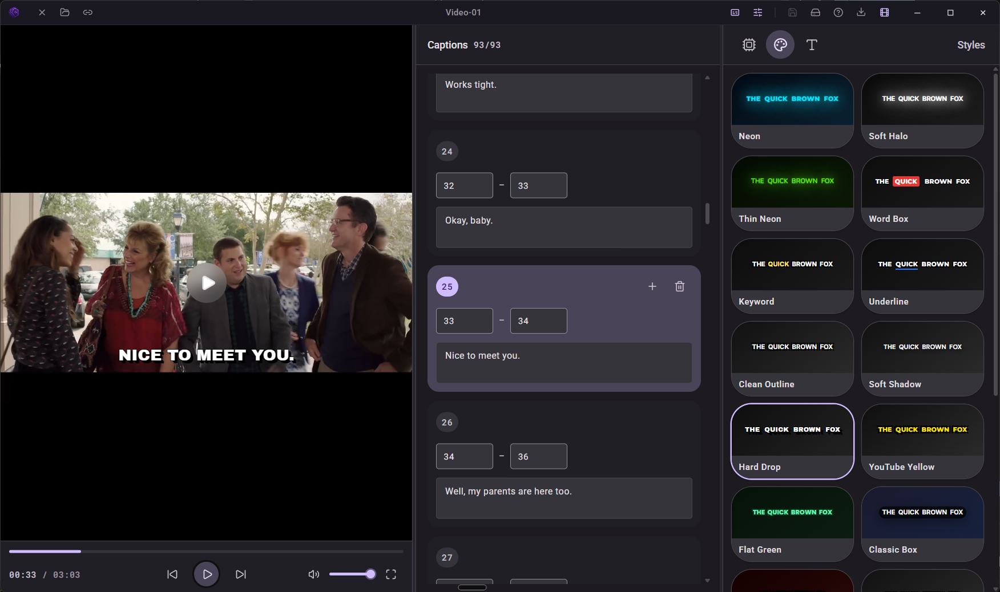
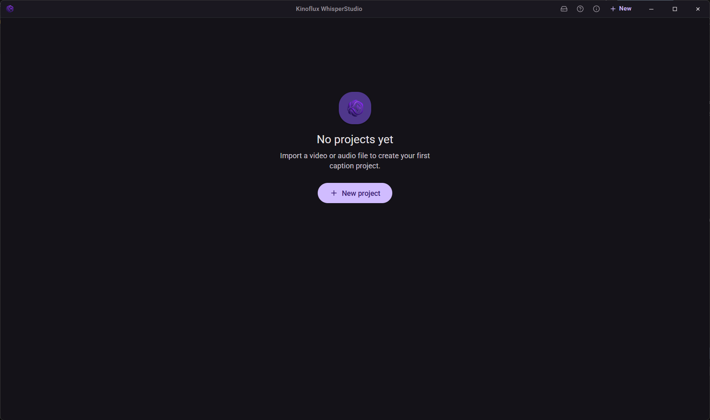
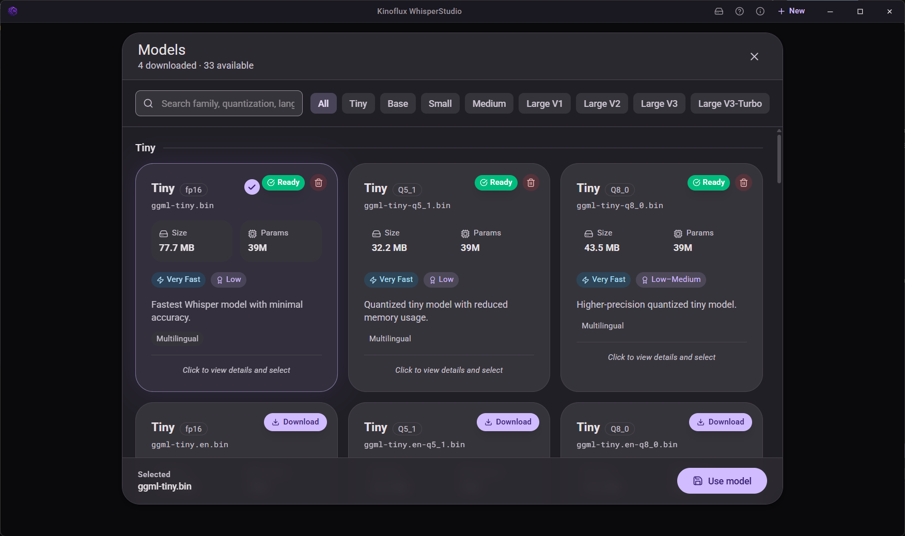
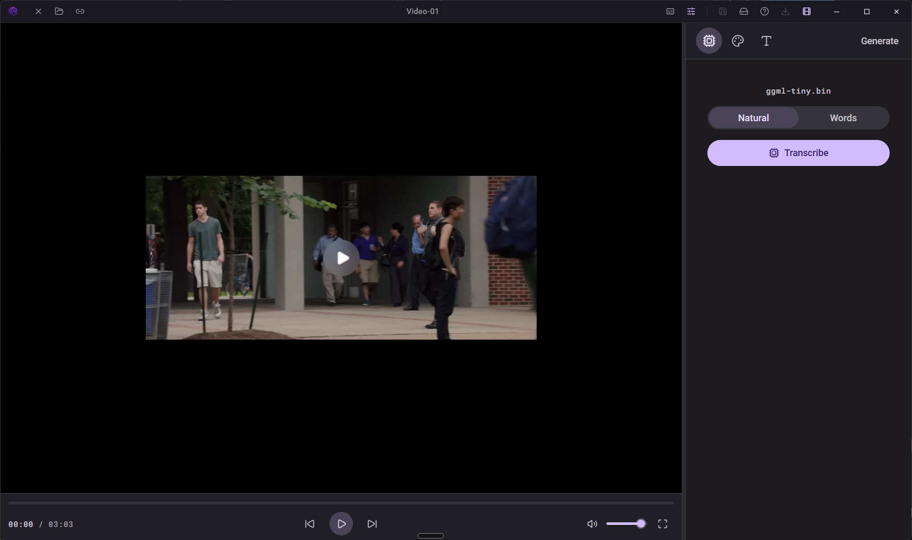
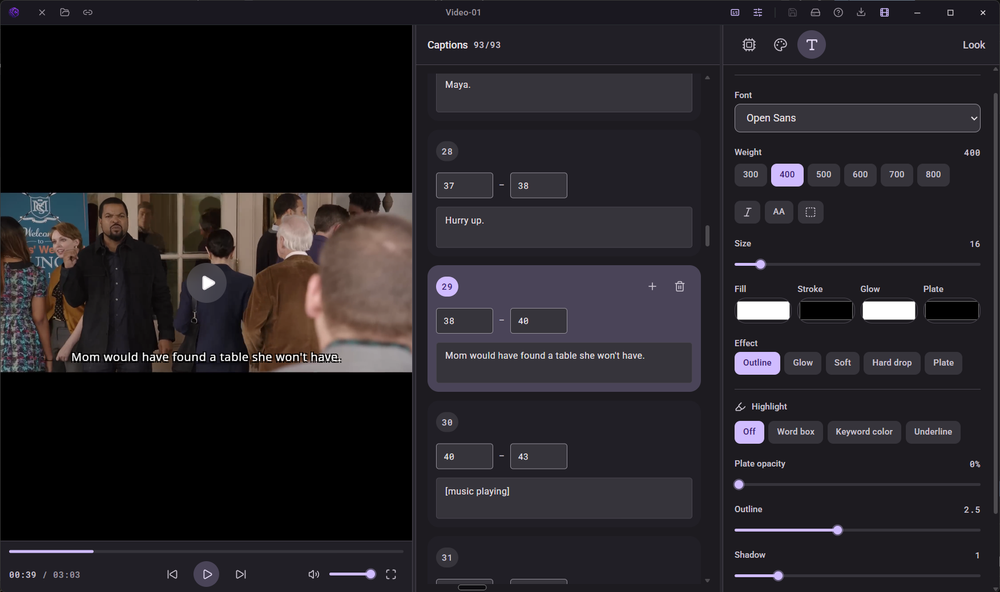

  

<h1 align="center">Kinoflux WhisperStudio</h1>

  <strong>Local AI captions for creators.</strong> 
  Transcribe, edit, style, and burn subtitles — privately on your machine.

  
  
  
  

  <a href="#download"><strong>Download v0.2.0</strong></a> ·
  <a href="https://ntxm.org/products/kinoflux/whisperstudio/">Website</a> ·
  <a href="https://github.com/ntxmproducts/kinoflux-whisperstudio/releases">All releases</a>

---

  

<em>Preview, edit, and style captions in one CapCut-like workspace — then burn them into the export.</em>

## Why WhisperStudio

Cloud transcription means uploading your voice. WhisperStudio keeps the whole pipeline on your hardware:

1. **Import** video or audio into a project library  
2. **Transcribe** with local OpenAI Whisper models  
3. **Edit & style** cues with live preview  
4. **Export** burned video, SRT, or plain text  

No subscriptions. No API keys for transcription. No telemetry.

---

## Download

| Platform | Installer | Link |
|----------|-----------|------|
| **Windows 10/11 (x64)** | MSI | [Kinoflux.WhisperStudio_0.2.0_x64_en-US.msi](https://github.com/ntxmproducts/kinoflux-whisperstudio/releases/download/v0.2.0/Kinoflux.WhisperStudio_0.2.0_x64_en-US.msi) |
| **macOS (Apple Silicon)** | DMG | [Kinoflux.WhisperStudio_0.2.0_aarch64.dmg](https://github.com/ntxmproducts/kinoflux-whisperstudio/releases/download/v0.2.0/Kinoflux.WhisperStudio_0.2.0_aarch64.dmg) |

Full release notes and assets: **[v0.2.0 on GitHub](https://github.com/ntxmproducts/kinoflux-whisperstudio/releases/tag/v0.2.0)**

> **Unsigned installer notice**  
> As an indie product, installers are currently unsigned. Windows SmartScreen or Gatekeeper may warn on first open. Choose **More info → Run anyway** (Windows) or allow the app in System Settings (macOS) if you trust the download from this repository. Use at your own risk.

**Requirements**

- Windows 10/11 x64, or macOS on Apple Silicon  
- ~4 GB RAM minimum (8 GB+ recommended for longer media / larger models)  
- Disk space for Whisper model downloads (one-time; models stay local)

---

## Product tour

### Project library

Start from a calm library — not a marketing homepage. Create projects from video or audio, reopen them later, rename, duplicate, or delete.

  

Projects persist under your app data folder. Source media stays linked by path; if a file moves, **Relink** restores the connection without losing captions.

### Local Whisper models

Browse Tiny → Large V3 families, pick quantization, download what you need, and mark one model as active. Multilingual and English-only builds are both supported.

  

### Transcribe in the editor

Open a project, choose **Natural** phrases or **Words**, set language (auto-detect or explicit), and run transcription with live progress.

  

### Styles that match the burn

Pick CapCut-style presets — neon, word box, keyword color, underline, outline, plate, and more — with a live preview over the video.

  

### Look controls

Fine-tune font family, weight, size, fill/stroke/glow, highlight mode, outline, and shadow. What you see in preview is what FFmpeg burns into the export.

  

---

## Features in v0.2.0

| Area | What you get |
|------|----------------|
| **Library** | Create / open / rename / duplicate / delete projects; cold start opens Library |
| **Persistence** | Autosave captions, style, layout; dirty indicator; resume playback position |
| **Media** | Video + audio import; missing-media status + Relink |
| **ASR** | On-device Whisper; natural or word-by-word; language auto / explicit |
| **Editing** | Cue list with timings; add / edit / delete; word grouping |
| **Design** | Template presets + Look panel; bundled fonts for preview/export parity |
| **Export** | Hard-burn MP4, plus SRT / TXT downloads |
| **Privacy** | Transcription and burn-in stay local after model download |

---

## Quick start

1. Install from the [v0.2.0 release](https://github.com/ntxmproducts/kinoflux-whisperstudio/releases/tag/v0.2.0).  
2. Launch **Kinoflux WhisperStudio** → **New project** → pick a media file.  
3. Open **Models**, download a Whisper build (start with Tiny or Base), then **Use model**.  
4. Choose **Natural** or **Words**, set language, hit **Transcribe**.  
5. Edit cues, apply a style, then **Export** video or download SRT/TXT.

---

## Privacy

- Audio and video are processed **on your device**.  
- Whisper weights download once over HTTPS (Hugging Face / catalog hosts), then run offline.  
- No cloud transcription API. No account required for local use.

Product site: [ntxm.org/products/kinoflux/whisperstudio](https://ntxm.org/products/kinoflux/whisperstudio/)

---

## FAQ

**Does my audio leave the machine?**  
No. Transcription runs locally after models are installed.

**Is it free?**  
Yes for personal use via the public installers. See license below for redistribution limits.

**Which models work?**  
Whisper Tiny through Large V3 (and Turbo where listed), including quantized builds for lower RAM.

**Windows warns that the app is unrecognized — is that expected?**  
Yes, until code-signing is in place. Download only from [this GitHub org’s releases](https://github.com/ntxmproducts/kinoflux-whisperstudio/releases).

**Where do projects live?**  
Under the app data directory for `org.ntxm.kinoflux-whisper-studio` (Windows AppData / macOS Application Support). Media files stay at their original paths.

---

## Links

| | |
|--|--|
| **Website** | [ntxm.org — WhisperStudio](https://ntxm.org/products/kinoflux/whisperstudio/) |
| **Latest release** | [v0.2.0](https://github.com/ntxmproducts/kinoflux-whisperstudio/releases/tag/v0.2.0) |
| **Windows MSI** | [Direct download](https://github.com/ntxmproducts/kinoflux-whisperstudio/releases/download/v0.2.0/Kinoflux.WhisperStudio_0.2.0_x64_en-US.msi) |
| **macOS DMG** | [Direct download](https://github.com/ntxmproducts/kinoflux-whisperstudio/releases/download/v0.2.0/Kinoflux.WhisperStudio_0.2.0_aarch64.dmg) |
| **NTXM** | [ntxm.org](https://ntxm.org) |

---

## License

Proprietary. All rights reserved.  
Commercial redistribution is not allowed without permission.

Built by **Nitiksh** · [NTXM](https://ntxm.org)
